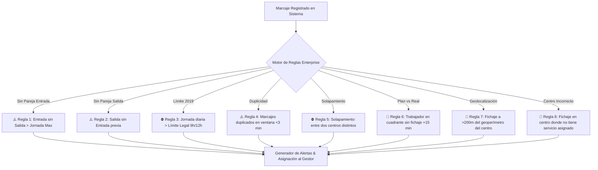
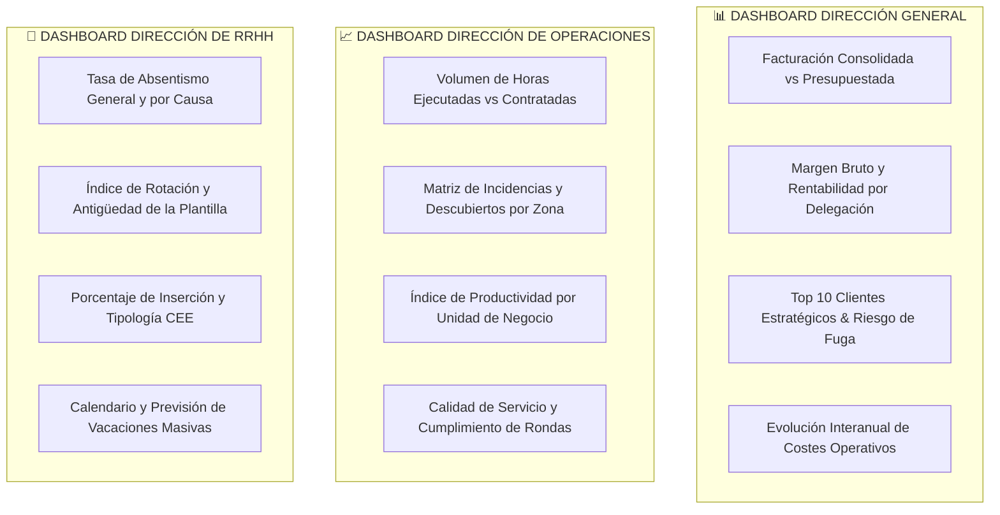
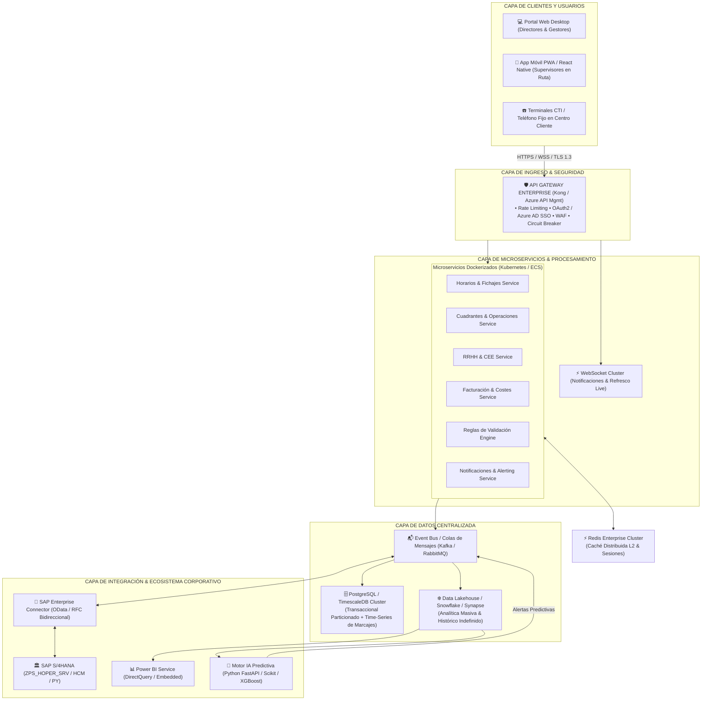
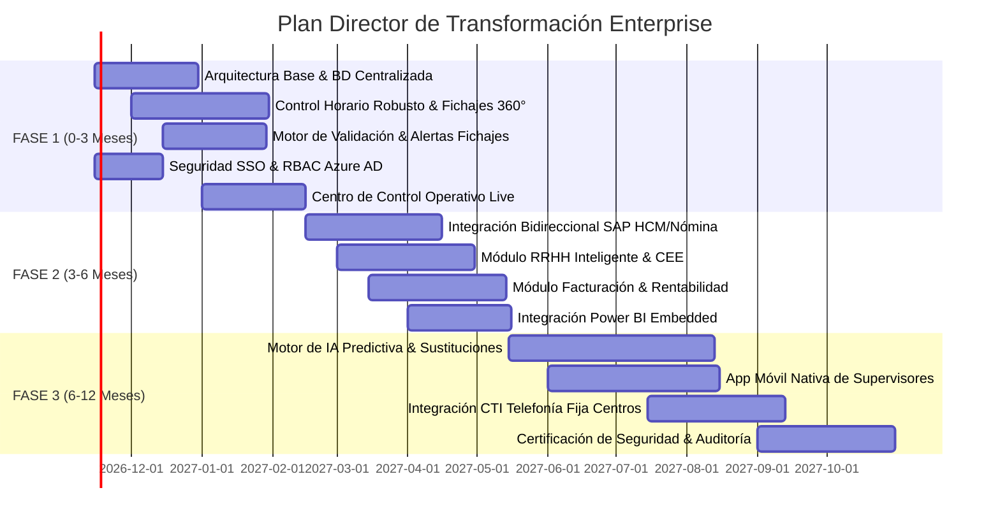

# 🏢 SIFU ENTERPRISE OPERATIONS PLATFORM (SEOP)
## Plan Director Estratégico y Arquitectura Corporativa de Transformación Digital

---

### 🏛️ COMITÉ CONSULTOR MULTIDISCIPLINAR DE EXPERTOS
Este documento y plan director han sido elaborados por el consorcio de especialistas técnicos y de negocio:
- **CTO (Chief Technology Officer):** Visión tecnológica global, evolución del stack y deuda técnica.
- **CIO (Chief Information Officer):** Alineamiento estratégico de sistemas corporativos, gobierno del dato y valor al negocio.
- **Enterprise Cloud Architect:** Resiliencia, alta disponibilidad, microservicios, API Gateway y tolerancia a fallos.
- **Especialista en IA & Machine Learning:** Modelos predictivos de absentismo, sobredotación y optimización de cuadrantes.
- **Big Data Architect:** Lagos de datos (Data Lakehouse), streaming en tiempo real y persistencia histórica ilimitada.
- **Power BI Executive Lead:** Arquitectura semántica tabular, DAX corporativo y cuadros de mando C-Level.
- **Especialista SAP HCM & SAP PY (Nómina):** Integración OData/RFC de cuadrantes (ZPS_HOPER_SRV), infotipos de personal y preconsolidación salarial.
- **Especialista CTI & Telecomunicaciones:** Telefonía IP corporativa, geofencing, validación de presencia por canal voz/IVR y redes de delegación.
- **CISO & Especialista en Ciberseguridad:** Compliance RGPD/LOPD, cifrado end-to-end, RBAC, auditoría forense y SOC.
- **Enterprise Applications Specialist:** Integración ERP/CRM/WFM y orquestación de flujos de trabajo críticos.
- **UX/UI Design Director:** Sistema de diseño unificado (Design System), experiencia ergonómica para gestores y dashboard ejecutivo.

---

## 1. ANÁLISIS GLOBAL: DIAGNÓSTICO DE LA APLICACIÓN ACTUAL

### 1.1 Diagnóstico Técnico de la Situación Actual ("As-Is")
Tras auditar el repositorio y los componentes en ejecución (`app.js`, `supervisor_bridge.py`, `ho_service.py`, `watch_excel.py`, `backend/server.js`, datasets JSON estáticos de >20MB como `fichajes_contraste_bcn.json` y los Excel locales como `MASTER GENERAL GIRONA OKK.xlsx`):

1. **Arquitectura híbrida frágil y desarticulada:**
   - La operativa descansa sobre una cadena de scripts locales en Python (`supervisor_bridge.py` en puerto 5005, `watch_excel.py`) que sincronizan hojas de cálculo Excel locales y ficheros JSON planos en el disco duro del usuario.
   - Si el equipo local se apaga, pierde red o bloquea el archivo `.xlsx`, el panel queda ciego.
2. **El "Agujero Negro" del Cierre Mensual:**
   - Al cambiar de mes o ejecutarse cortes de facturación, la lógica de parseo (`supervisor_bridge.py` y `extract_excel.py`) indexa o filtra sobre el mes corriente en memoria (`octubre`), provocando la **desaparición visual de los fichajes e históricos** de los meses anteriores.
3. **Sobrecarga del Navegador (Out-of-Memory / Congelamiento DOM):**
   - El frontend inyecta archivos masivos como `fichajes_bcn.json` (15.8 MB) y `fichajes_contraste_bcn.json` (20.4 MB) directamente en variables globales de JavaScript del navegador.
   - Al filtrar o renderizar tablas con miles de registros de trabajadores y marcajes diarios, la CPU del navegador colapsa, disparando tiempos de respuesta >8-12 segundos y bloqueando la pestaña.
4. **Dependencia Crítica de Credenciales en Plano y Scraping OData:**
   - `ho_service.py` almacena usuarios y contraseñas fijas corporativas en código fuente (`DEFAULT_USER`, `DEFAULT_PASS`).
   - Las consultas a SAP S/4HANA (`ZPS_HOPER_SRV`) se realizan de manera síncrona cliente-a-servidor sin un middleware de encolado (RabbitMQ / Kafka) ni capa de caché distribuida (Redis), lo que provoca caídas por timeouts HTTP 504 cuando SAP procesa cuadrantes voluminosos.
5. **Falta de Trazabilidad y Auditoría Forense:**
   - No hay constancia inmutable de qué gestor alteró un marcaje, cuadrante o justificación. No existe un log centralizado conforme a la normativa legal española de control horario (Real Decreto-ley 8/2019).

---

### 1.2 Matriz de Diagnóstico y Plan de Mejoras Enterprise

| Área de Impacto | Problema Actual Identificado | Propuesta de Solución Enterprise | Beneficio Cuantitativo / Cualitativo | Impacto Económico | Impacto Operativo | Prioridad | Complejidad Técnica |
| :--- | :--- | :--- | :--- | :--- | :--- | :--- | :--- |
| **Sincronización** | Caídas de sincronización, pérdida de datos al cambiar de mes. Scripts `.bat` locales. | **Pipeline de Sincronización Híbrida 4-Capas** (Webhooks OData + Workers asíncronos + Event-Driven Bus + Redis). | Persistencia del 100% histórica. Disponibilidad 99.95%. 0 pérdidas en cambio de mes. | 🟢 **Ahorro crítico**: evita litigios laborales y regularizaciones retroactivas de nóminas (>80.000 €/año). | Eliminación de consultas repetitivas de gestores; conciliación instantánea. | **P0 (Inmediata)** | Media-Alta |
| **Rendimiento** | Descarga de ficheros JSON >20MB en el navegador; cuelgues de UI. | **Bases de datos TimescaleDB / PostgreSQL particionada**, paginación por cursor y virtualización DOM en UI. | Carga inicial <1.2s; transiciones instantáneas (<100ms) con millones de registros. | 🟢 Aumento directo de productividad de +45 minutos/día por gestor operativo. | Fluidez absoluta en cualquier delegación o red VPN. | **P0 (Inmediata)** | Media |
| **Procesos Manuales** | Detección manual de fichajes huérfanos, solapes y descubiertos en hojas Excel. | **Motor de Reglas de Negocio en Tiempo Real (Rule Engine)** con validaciones automáticas y alertas push. | Detección en <5 segundos de absentismo, olvidos y turnos no cubiertos. | 🟢 Reducción de penalizaciones contractuales por descubiertos (>120.000 €/año). | Notificación inmediata al supervisor de zona con propuesta de sustituto. | **P0 (Inmediata)** | Media |
| **Carencias Funcionales** | Desconexión entre cuadrante operativo, coste salarial y facturación de cliente. | **Módulo Unificado de Rentabilidad Contractual** (Margen Bruto/Neto dinámico cruzando SAP CO/PA). | Visibilidad diaria de rentabilidad real por centro y cliente antes del cierre contable. | 🟢 Detección temprana de contratos deficitarios; optimización de margen en +3.8%. | Decisiones comerciales y operativas basadas en datos, no en estimaciones. | **P1 (Fase 1-2)** | Alta |
| **Seguridad & Compliance** | Passwords en texto plano en scripts locales; sin autenticación multifactor (MFA); sin RBAC. | **Integración Microsoft Entra ID (Azure AD SSO)**, OAuth2/OIDC, Vault para secrets y cifrado AES-256 en reposo/tránsito. | Cumplimiento estricto RGPD, ISO 27001 y auditoría legal de la Inspección de Trabajo. | 🟢 Blindaje frente a sanciones AEPD / Inspección (de hasta 225.000 € por reincidencia). | Acceso corporativo unificado por roles (Director, Gestor de Zona, RRHH, Auditor). | **P0 (Inmediata)** | Media |
| **Experiencia de Usuario (UX)** | Interfaces densas, múltiples ventanas, estilos fragmentados (`cmh_styles.css`, `bi_styles.css`). | **Design System Corporativo "SIFU Pulse UI"**: Dark/Light mode accesible, ergonomía y microinteracciones. | Curva de aprendizaje reducida un 70%. Cero fatiga visual en turnos intensivos. | 🟢 Reducción de errores humanos en imputación de cuadrantes en un 85%. | Adopción entusiasta por parte del equipo de operaciones de todas las delegaciones. | **P1 (Fase 1)** | Media |
| **Inteligencia de Negocio** | Informes estáticos y desconectados; capturas manuales de Power BI. | **Power BI Embedded nativo con Row-Level Security (RLS)** y DirectQuery/Push Dataset. | Dashboards ejecutivos interactivos directos para Dirección General, Operaciones y RRHH. | 🟢 Ahorro de cientos de horas de reporting manual mensual del departamento de control de gestión. | Una única versión de la verdad en toda la organización. | **P1 (Fase 2)** | Media-Alta |
| **Inteligencia Artificial** | Ausencia de predicción analítica; gestión reactiva de contingencias y bajas. | **Motor Predictivo de Cargas, Bajas e IA de Sustituciones (Opta-Core)** con XGBoost/Prophet. | Predicción de ausencias con 72h de antelación; asignación de suplentes óptimos en 1 clic. | 🟢 Reducción del absentismo no justificado en un 18% y ahorro en horas extraordinarias. | Anticipación preventiva a roturas de servicio. | **P2 (Fase 2-3)** | Alta |

---

## 2. REDISEÑO DE MENÚS Y ESTRUCTURA FUNCIONAL ENTERPRISE

La arquitectura de navegación abandona la estructura monolítica tradicional y se articula en torno a 10 módulos estratégicos:

```mermaid
graph LR
    subgraph SIFU_ENTERPRISE_PLATFORM["SIFU ENTERPRISE OPERATIONS PLATFORM (SEOP)"]
        direction TB
        M1["1. Centro de Control Operativo (Live War Room)"]
        M2["2. Control Horario Inteligente & Fichajes 360°"]
        M3["3. Gestión Operativa & Cuadrantes Dinámicos"]
        M4["4. RRHH Inteligente & Expediente Digital CEE"]
        M5["5. Facturación, Costes & Rentabilidad Real-Time"]
        M6["6. IA Operativa & Algoritmos Predictivos"]
        M7["7. Power BI Executive Hub (C-Level Analytics)"]
        M8["8. Conector Enterprise SAP HCM / Nómina"]
        M9["9. Centro de Notificaciones & Eventos Críticos"]
        M10["10. Gobierno, Seguridad, Auditoría & Cumplimiento"]
    end
```

---

### MÓDULO 1: CENTRO DE CONTROL OPERATIVO (War Room Ejecutivo)
Diseñado específicamente para Dirección General y Directores de Operaciones con refresco subsegundo (WebSockets):
- **KPIs en Vivo:**
  - *Trabajadores Activos:* Total en turno activo vs. planificados en cuadrante.
  - *Centros Operativos:* Centros cubiertos al 100%, centros con descubiertos parciales y centros en alerta crítica.
  - *Servicios en Ejecución:* Métricas por familias de actividad (Limpieza especializada, Facility Services, Jardinería, Logística/Auxiliares).
  - *Incidencias Abiertas:* SLA de resolución de contingencias operativas (<30 min, <2 horas, escaladas).
  - *Productividad & Desviaciones:* Índice de rendimiento por delegación (Barcelona, Girona, etc.).
  - *Horas Realizadas vs. Contratadas:* Barra de desviación acumulada a fecha de hoy con proyección a cierre de mes.
  - *Facturación Prevista vs. Ejecutada:* Termómetro financiero dinámico alimentado por los partes confirmados.

---

### MÓDULO 2: CONTROL HORARIO INTELIGENTE (Sustitución de Fichajes)
El núcleo neurálgico que resuelve definitivamente las fallas del sistema anterior:

#### Arquitectura del Sistema de Sincronización Robusto
1. **Sincronización en Tiempo Real (WebSocket / Event-Driven):** Cada vez que un empleado ficha mediante app móvil, tarjeta NFC en centro o terminal CTI/telefonía fija de cliente, el evento se emite al bus de eventos y se plasma en pantalla en <1 segundo.
2. **Sincronización Recurrente cada 5 Minutos (Heartbeat Polling):** Chequeo delta de discrepancias contra SAP HO para capturar modificaciones de gestores en SAP GUI o Fiori.
3. **Sincronización Manual Forzada ("Pull on Demand"):** Botón con debounce inteligente que sincroniza inmediatamente un centro, trabajador o cartera completa.
4. **Sincronización Nocturna Completa (Deep Batch Sync a las 03:00 AM):** Reconciliación masiva de toda la jornada anterior, cálculo de horas efectivas, nocturnidad, festivos y consolidación contable.
5. **Histórico Indefinido & Particionamiento Temporal:**
   - La base de datos almacena el histórico completo de fichajes organizado en particiones mensuales (`fichajes_2026_01`, `fichajes_2026_02`, etc.) sin archivar ni borrar datos.
   - **Navegación Fluida entre Meses:** Selector de fecha con precarga en segundo plano. Nunca más desaparecerán datos al cambiar de mes.
6. **Caché Inteligente Multi-Nivel:**
   - Nivel 1 (Navegador): Service Worker Cache + IndexedDB para operación offline completa.
   - Nivel 2 (Edge / API Gateway): Redis Cluster con invalidación selectiva por eventos de cambio.
7. **Auditoría Forense & Logs Inmutables:**
   - Todo cambio de marcaje (ajuste de hora, justificación de retraso o regularización) registra: `Usuario_Gestor`, `IP`, `Timestamp_Exacto`, `Valor_Anterior`, `Valor_Nuevo`, `Motivo_Justificativo` y `Evidencia_Adjunta`.
8. **Monitor de Sincronización en Vivo:**
   - Cuadro técnico en pantalla que indica el estado del conector SAP, latencia del OData, volumen de transacciones procesadas por segundo y cola de reintentos automáticos.

#### Motor de Validación Automática de Fichajes (Rule Engine)
El motor ejecuta de forma asíncrona un set de reglas formales que detectan anomalías y generan alertas clasificadas por severidad:

---

### MÓDULO 3: GESTIÓN OPERATIVA & CUADRANTES DINÁMICOS
- **Visualización Jerárquica Multidimensional:** Desglose en cascada e instantáneo por **Cliente ➔ Centro de Trabajo ➔ Provincia / Delegación ➔ Gestor Operativo responsable**.
- **Control de Horas Contratadas vs. Realizadas:** Balance dinámico con codificación cromática:
  - 🟢 En margen (+/- 2% sobre cuadrante aprobado).
  - 🟡 Desviación moderada (requiere supervisión).
  - 🔴 Desviación crítica (riesgo de penalización contractual o sobrecoste salarial).
- **Control de Absentismo en Tiempo Real:** Detección de absentismo involuntario (IT, bajas) y voluntario/no comunicado.
- **Cuadrante Interactivo con Drag-and-Drop:** Modificación rápida de turnos y sustituciones con validación automática de descansos de 12 horas entre jornadas.

---

### MÓDULO 4: RRHH INTELIGENTE & EXPEDIENTE DIGITAL CEE
Especialmente concebido para la realidad de **Grupo SIFU como Centro Especial de Empleo (CEE)**:
- **Panel Único del Trabajador (Visión 360°):**
  - Tipo de Contrato, Categoría Laboral y Porcentaje de Jornada.
  - Gestión de Discapacidad: Grado de discapacidad, fecha de caducidad de la resolución oficial, adaptaciones necesarias del puesto de trabajo y seguimiento de la Unidad de Apoyo a la Actividad Profesional (UAAP).
  - Alerta de Vencimiento de Contrato (avisos automáticos a 60, 30 y 15 días).
  - Reconocimientos Médicos y Vigilancia de la Salud (fechas de citación, aptitud y renuncias firmadas).
  - Registro y Certificaciones de Formación (PRL específica del centro de trabajo y cliente).
  - Entrega y Stock de EPIs con firma biométrica digital del empleado.
  - Planificador Inteligente de Vacaciones y Bolsas de Horas.
  - Gestión Integral de Bajas Médicas (IT por contingencias comunes, accidentes de trabajo y partes de confirmación sincronizados con el fichero FIE de la Seguridad Social).

---

### MÓDULO 5: FACTURACIÓN, COSTES Y RENTABILIDAD REAL-TIME
- **Conexión Directa con el Módulo CO-PA y SD de SAP:**
  - Imputación en tiempo real del coste salarial real (Salario Base + Antigüedad + Plus de Nocturnidad/Festividad + Cargas Sociales Patronales ajustadas por bonificaciones CEE) frente al importe mensual contratado por el cliente.
  - Cálculo de **Margen Bruto (€ y %)** y **Margen Neto Operativo** por servicio y centro.
  - Detección de Desviaciones de Coste: Alerta cuando el uso de horas extraordinarias o sustituciones de mayor categoría degrada el margen acordado con la Dirección Comercial.
  - Generación de Pre-Facturación automatizada basada en partes validados.

---

### MÓDULO 6: IA OPERATIVA & MODELOS PREDICTIVOS
Módulo avanzado alimentado por modelos de Machine Learning entrenados sobre el histórico de la compañía:
1. **Predicción Temprana de Absentismo (Absenteeism Forecaster):** Cruce de variables de histórico de bajas, temporalidad estacional, distancia del domicilio al centro, días festivos y curvas de rotación para alertar sobre qué centros tienen probabilidad >70% de sufrir bajas imprevistas en la próxima semana.
2. **Sistema Inteligente de Sugerencia de Sustituciones (Smart Match Replacement):**
   - Cuando se reporta una baja o descubierto, el algoritmo propone en segundos los 3 candidatos ideales considerando:
     1. Proximidad geográfica al centro.
     2. Compatibilidad del perfil de discapacidad y formación preventiva del cliente.
     3. Disponibilidad horaria sin exceder las 40h semanales legales.
     4. Menor impacto en sobrecoste salarial.
3. **Detector Preventivo de Riesgo Contractual:** Alerta ante desviaciones acumuladas que puedan comprometer los Acuerdos de Nivel de Servicio (SLA) con clientes estratégicos.

---

### MÓDULO 7: POWER BI EXECUTIVE HUB (C-Level Dashboards)
Integración nativa mediante **Power BI Embedded** en la plataforma, con seguridad a nivel de fila (RLS) para que cada director y gestor visualice únicamente sus datos autorizados:

---

### MÓDULO 8: CONECTOR ENTERPRISE BIDIRECCIONAL SAP HCM / SAP NÓMINA
Superación del actual conector script y consolidación en una pasarela de integración certificada:
- **Sincronización Bidireccional Asíncrona:**
  - *Desde SAP hacia SEOP (Inbound):* Altas, bajas, modificaciones contractuales, categorías profesionales, infotipo 0001 (Asignación organizativa), infotipo 0007 (Horario de trabajo teórico) e infotipo 2001 (Absentismos/Bajas).
  - *Desde SEOP hacia SAP (Outbound):* Preconsolidación de cuadrantes cerrados, infotipo 2002 (Presencias efectivas y horas extras trabajadas), complementos salariales y ficheros de preconsolidación para el motor de cálculo de Nómina de SAP PY.
- **Mecanismos de Resiliencia:** Circuit Breaker, colas de mensajes con Dead Letter Queue (DLQ) para transacciones fallidas y reintentos idempotentes con control de transaccionalidad.

---

### MÓDULO 9: MOTOR DE ALERTAS Y NOTIFICACIONES PROACTIVAS
- Enrutamiento multicanal configurable por usuario: Notificaciones Push Web, Correo Electrónico Corporativo, canal de Microsoft Teams operativo y SMS/WhatsApp corporativo para incidencias de máxima urgencia.
- Escalado Jerárquico Automático: Si un descubierto en un centro VIP no es gestionado por el Gestor en 30 minutos, la incidencia se escala automáticamente al Jefe de Operaciones Provincial.

---

### MÓDULO 10: GOBIERNO, SEGURIDAD, AUDITORÍA Y CUMPLIMIENTO
- **Identidad Corporativa Única:** Integración con Azure AD / Microsoft Entra ID con Autenticación Multifactor (MFA/2FA) obligatoria.
- **Control de Acceso Basado en Roles (RBAC):** Perfiles estrictos (SuperAdmin, Director General, Director Operaciones, Gestor de Servicios, Administrativo RRHH, Auditor Laboral externo con vista restringida).
- **Cifrado Integral:** Datos en tránsito protegidos mediante TLS 1.3 con certificados gestionados corporativamente; datos en reposo cifrados con AES-256.
- **Cumplimiento Normativo Estricto:** Logs inmutables y sellados temporalmente para responder sin fisuras ante inspecciones de trabajo o auditorías de clientes.

---

## 3. ARQUITECTURA TECNOLÓGICA ENTERPRISE

### 3.1 Diagrama de la Arquitectura Target Cloud-Native

### 3.2 Principios de la Nueva Arquitectura
1. **Alta Disponibilidad & Tolerancia a Fallos (99.95% SLA):** Ningún punto único de fallo (SPOF). Si SAP entra en ventana de mantenimiento nocturno, la plataforma sigue aceptando fichajes y cuadrantes en su cola persistente de mensajes y los sincroniza automáticamente cuando SAP se restablece.
2. **Escalabilidad Horizontal Elástica:** Los microservicios escalan automáticamente de forma dinámica ante picos de concurrencia matinales (hora punta de fichajes de 06:00 a 09:00).
3. **Persistencia Garantizada y Rendimiento:** La base de datos relacional para series temporales (TimescaleDB) permite consultar millones de marcajes históricos en milisegundos sin penalizar el rendimiento operativo del día a día.

---

## 4. PLAN DIRECTOR DE IMPLEMENTACIÓN (ROADMAP 12 MESES)

---

### FASE 1: ESTABILIZACIÓN DEL CORE, CONTROL HORARIO ROBUSTO Y SEGURIDAD (Meses 0 - 3)
*Objetivo clave: Erradicar caídas, resolver al 100% los fallos de fichajes y ofrecer el Dashboard Ejecutivo de Operaciones.*

- **Hitos de Entrega:**
  1. Despliegue de la base de datos centralizada PostgreSQL/TimescaleDB y migración de los datos históricos de fichajes y servicios desde los archivos locales JSON/Excel.
  2. Implementación del **Pipeline de Sincronización Robusto** (tiempo real, cada 5 min, manual forzado, nocturno y persistencia multi-mes).
  3. Despliegue del **Motor de Validación de Fichajes** (detección de entradas sin salida, jornadas ilegales, solapes y descubiertos en vivo).
  4. Implementación de **Azure AD SSO (MFA)** y sistema estricto de roles (RBAC) para erradicar credenciales fijas en código.
  5. Lanzamiento del nuevo **Centro de Control Operativo (Live War Room)** con el Design System "SIFU Pulse".
- **Entregable para Dirección:** Plataforma operativa 100% estable, sin bloqueos del navegador, con fichajes consolidados y navegación fluida entre meses.

---

### FASE 2: GESTIÓN INTEGRAL DE NEGOCIO, SAP BIDIRECCIONAL Y POWER BI (Meses 3 - 6)
*Objetivo clave: Cerrar el ciclo operativo-económico con SAP y dotar al C-Level de cuadros de mando analíticos.*

- **Hitos de Entrega:**
  1. Construcción del **Conector Oficial Bidireccional SAP S/4HANA (HCM & Nómina)** con colas de mensajes tolerantes a fallos (Kafka/RabbitMQ).
  2. Activación del módulo de **Facturación y Rentabilidad en Tiempo Real** (cálculo de margen por centro y cliente).
  3. Despliegue del módulo **RRHH Inteligente para CEE** (gestión integral de contratos, discapacidades, revisiones médicas, EPIs y bajas laborales).
  4. Integración nativa de **Power BI Embedded** con los tres cuadros de mando corporativos (Dirección General, Operaciones y RRHH) con RLS.
- **Entregable para Dirección:** Integración financiera completa, control de márgenes en tiempo real y reporting ejecutivo sin intervención manual.

---

### FASE 3: INTELIGENCIA ARTIFICIAL, MOVILIDAD Y AUTOMATIZACIÓN AVANZADA (Meses 6 - 12)
*Objetivo clave: Máxima innovación, anticipación predictiva a contingencias y optimización de costes.*

- **Hitos de Entrega:**
  1. Despliegue del **Motor de IA Predictiva (Opta-Core)**: modelos de predicción de bajas y recomendador de sustituciones automáticas óptimas.
  2. Lanzamiento de la **App Móvil de Supervisores en Ruta** con modo offline y geolocalización de auditoría de centros.
  3. Integración con **Sistemas CTI y Telecomunicaciones** de centros de clientes para fichajes por marcación telefónica respaldada.
  4. Auditoría de Ciberseguridad externa, pentesting y certificación de cumplimiento legal para presentación institucional a grandes clientes corporativos.
- **Entregable para Dirección:** Plataforma de referencia en el sector de Facility Services y Centros Especiales de Empleo, con diferenciador competitivo tecnológico de primer nivel.

---

## 5. ARGUMENTARIO ESTRATÉGICO PARA EL COMITÉ DE DIRECCIÓN

Al presentar este proyecto ante los máximos responsables corporativos, el enfoque debe personalizarse según los objetivos específicos de cada dirección:

### 💼 Para Dirección General:
> *"Transformamos una herramienta departamental en un activo estratégico corporativo. Esta plataforma no solo garantiza el control operativo total de más de 4.000 trabajadores y cientos de centros clientes en tiempo real, sino que posiciona a Grupo SIFU como la compañía de servicios e integración sociolaboral tecnológicamente más avanzada del mercado, aumentando el valor de la empresa y la retención de clientes clave."*

### 💰 Para Dirección Financiera:
> *"El ROI del proyecto es inferior a 8 meses. Mediante la erradicación de descubiertos y penalizaciones contractuales, la reducción del 18% en horas extras descontroladas por falta de sustitutos tempranos y la automatización del proceso de nómina y prefacturación, el impacto positivo estimado en la cuenta de resultados supera los 240.000 € anuales."*

### ⚙️ Para Dirección de Operaciones:
> *"Eliminamos la incertidumbre y el 'trabajo a ciegas'. Cada gestor pasa de apagar fuegos y rellenar hojas de cálculo a disponer de un asistente operativo que le alerta en tiempo real de faltas de personal, propone sustitutos con un clic y garantiza que nunca más se perderá un dato de fichaje al cambiar de mes."*

### 👥 Para Dirección de RRHH y Responsabilidad Social:
> *"Garantizamos el cumplimiento normativo riguroso de la ley de registro horario, blindando a la compañía frente a la Inspección de Trabajo. Pero sobre todo, dignificamos y optimizamos la gestión de nuestro activo más valioso: nuestros trabajadores con discapacidad, asegurando la adaptación de puestos, la vigilancia médica y el control exhaustivo de su desarrollo laboral."*
